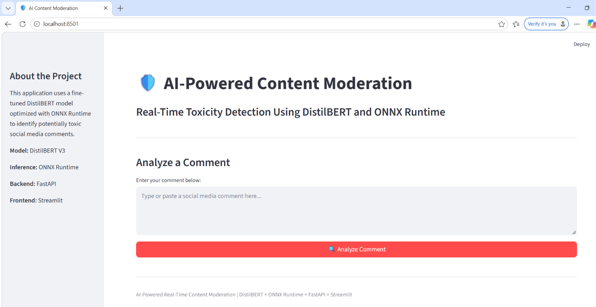
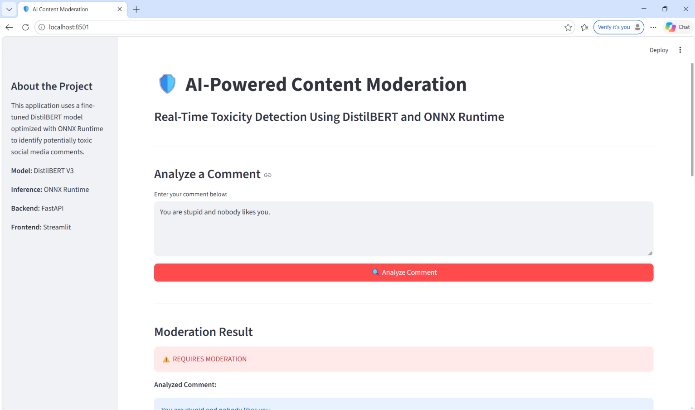
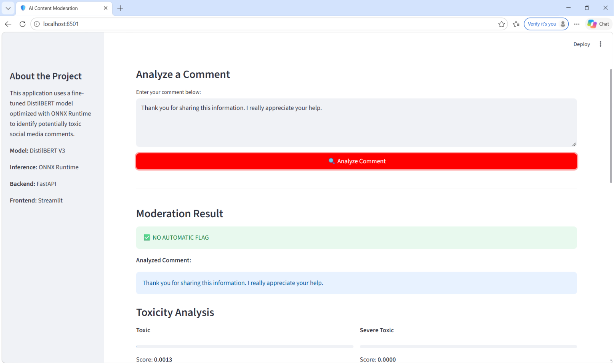
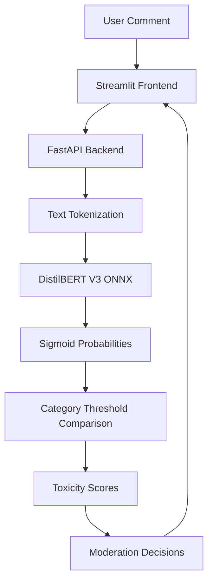

# AI-Powered Real-Time Content Moderation Using DistilBERT and ONNX Runtime

<p align="center">
  <strong>An NLP-powered system for detecting and flagging harmful social media comments using Deep Learning.</strong>
</p>

<p align="center">
  
  
  
  
  
  
</p>

## Project Overview

AI-Powered Real-Time Content Moderation is a Natural Language Processing (NLP) application designed to identify potentially harmful content in social media comments.

The system uses a fine-tuned **DistilBERT transformer model** to perform multi-label toxicity classification. The model is optimized using **ONNX Runtime** for faster CPU inference and integrated with a **FastAPI backend** and **Streamlit frontend**.

It analyzes user-submitted comments and identifies potentially harmful categories, helping moderators review inappropriate content.

## Key Features

- Multi-label toxicity classification across six categories.
- Fine-tuned DistilBERT transformer model.
- Class-imbalance handling during model training.
- Per-category decision thresholds.
- ONNX model export and optimized CPU inference.
- REST API using FastAPI.
- Interactive Streamlit user interface.
- Individual toxicity scores and moderation decisions.

## Application Screenshots

### 1. Main Application Interface

The Streamlit interface allows users to submit comments for real-time toxicity analysis.



### 2. Toxic Comment Detection

Demonstrates the model identifying potentially harmful content and displaying category-wise toxicity scores and moderation decisions.



### 3. Non-Toxic Comment Detection

Demonstrates how the application analyzes a normal comment and displays its prediction results.



## Toxicity Categories

| Category | Description |
|---|---|
| Toxic | Generally harmful or abusive language |
| Severe Toxic | Highly aggressive or extremely harmful language |
| Obscene | Obscene or explicit language |
| Threat | Threatening language |
| Insult | Insulting or demeaning language |
| Identity Hate | Identity-based hateful language |

## Technology Stack

| Area | Technologies |
|---|---|
| Programming | Python |
| Deep Learning | PyTorch |
| NLP | Hugging Face Transformers |
| Pre-trained Model | DistilBERT |
| Data Processing | Pandas, NumPy |
| Machine Learning | Scikit-learn |
| Model Optimization | ONNX, ONNX Runtime |
| Backend | FastAPI, Uvicorn |
| Frontend | Streamlit |
| Dataset | Jigsaw Toxic Comment Classification |

## Dataset

The project uses the **Jigsaw Toxic Comment Classification Challenge** dataset.

The dataset contains social media comments labeled across six toxicity categories.

- Original dataset: approximately 159,571 comments.
- Training sample used for V3: 30,000 comments.
- Validation sample: 2,000 comments.
- Classification approach: Multi-label classification.

Dataset source: [Jigsaw Toxic Comment Classification Challenge](https://www.kaggle.com/c/jigsaw-toxic-comment-classification-challenge)

## Model Development

The project was developed through three training iterations:

- **V1:** Initial DistilBERT baseline.
- **V2:** Increased training sample size and introduced positive class weights.
- **V3:** Expanded training sample to 30,000 comments and evaluated improved classification performance.

### Final Model Configuration

| Parameter | Value |
|---|---|
| Base Model | distilbert-base-uncased |
| Training Samples | 30,000 |
| Epochs | 1 |
| Batch Size | 8 |
| Maximum Sequence Length | 128 |
| Learning Rate | 2e-5 |
| Classification | Multi-label |
| Loss Function | Weighted Binary Cross Entropy |

## Model Evaluation

The V3 model was evaluated on 29,915 test comments.

| Metric | Result |
|---|---:|
| Micro F1 | 0.6993 |
| Macro F1 | 0.5613 |
| Micro Precision | 0.5761 |
| Micro Recall | 0.8896 |
| Exact Match Accuracy | 0.8923 |

### Category-wise F1 Scores

| Toxicity Category | F1 Score |
|---|---:|
| Toxic | 0.79 |
| Severe Toxic | 0.43 |
| Obscene | 0.76 |
| Threat | 0.24 |
| Insult | 0.68 |
| Identity Hate | 0.46 |

**Evaluation note:** The test set was used in multiple model comparisons, so it should not be considered an untouched final benchmark. Rare categories also have relatively low positive support, which affects the reliability of their individual metrics.

## ONNX Runtime Optimization

The trained V3 model was exported to ONNX format and tested against the original PyTorch model.

The comparison showed close numerical agreement between the two inference implementations.

### CPU Inference Benchmark

| Runtime | Average Inference Time |
|---|---:|
| PyTorch | 17.538 ms |
| ONNX Runtime | 7.240 ms |

**Measured speedup: 2.42x**

The benchmark used single-comment inference, with 10 warm-up iterations and 50 measured iterations. These measurements represent model inference time, not complete application response time.

## System Architecture



## Project Structure

```text
real-time-content-moderation/
│
├── notebooks/
│   ├── 01_explore_dataset.py
│   └── 02_visualize_dataset.py
│
├── screenshots/
│   ├── app_interface.png
│   ├── toxic_detection.png
│   └── non_toxic_detection.png
│
├── src/
│   ├── api/
│   │   └── main.py
│   │
│   ├── inference/
│   │   └── 12_test_moderation_pipeline.py
│   │
│   ├── preprocessing/
│   │   ├── 01_preprocess_data.py
│   │   └── 02_tokenize_data.py
│   │
│   └── training/
│       ├── dataset.py
│       ├── 01_test_dataloader.py
│       ├── 02_train_distilbert.py
│       ├── 03_evaluate_model.py
│       ├── 04_threshold_analysis.py
│       ├── 05_per_label_thresholds.py
│       ├── 06_prepare_test_data.py
│       ├── 07_final_test_evaluation.py
│       ├── 08_train_distilbert_v2.py
│       ├── 09_v2_threshold_analysis.py
│       ├── 10_v2_test_evaluation.py
│       ├── 11_v2_precision_thresholds.py
│       └── 12_analyze_training_distribution.py
│
├── outputs/
│   └── v3_label_thresholds.json
│
├── app.py
├── requirements.txt
├── README.md
└── .gitignore
```

**Note:** The `data/`, `models/`, and large generated output files are excluded from GitHub to avoid uploading large datasets and model binaries.

## Installation and Execution

### 1. Clone the Repository

```bash
git clone https://github.com/harrisvizz/real-time-content-moderation.git
cd real-time-content-moderation
```

### 2. Create a Virtual Environment

```bash
python -m venv venv
```

Activate it on Windows:

```powershell
venv\Scripts\activate
```

### 3. Install Dependencies

```bash
pip install -r requirements.txt
```

### 4. Prepare Model Files

The trained V3 model and ONNX model are not included in this GitHub repository because of their size.

Before running the application, obtain the trained model artifacts and place them in the following locations:

```text
models/
└── distilbert_toxicity_v3/

outputs/
├── v3_label_thresholds.json
└── distilbert_toxicity_v3_onnx/
    └── model.onnx
```

The V3 model directory must also contain the required tokenizer and model configuration files.

### 5. Start the FastAPI Backend

```bash
python -m uvicorn src.api.main:app --reload
```

API documentation:

[http://127.0.0.1:8000/docs](http://127.0.0.1:8000/docs)

### 6. Start the Streamlit Frontend

Open another terminal, activate the virtual environment, and run:

```bash
python -m streamlit run app.py
```

### 7. Open the Application

[http://localhost:8501](http://localhost:8501)

## Moderation Decisions

The application returns toxicity scores and category-specific moderation decisions.

- **FLAGGED:** The category score meets or exceeds its configured threshold and requires moderation.
- **HUMAN_REVIEW:** The category requires further review under the inference decision rules.
- **NO_AUTOMATIC_FLAG:** No configured automatic moderation threshold was reached.

A flagged comment is sent for review; it is not automatically deleted. An unflagged comment is not guaranteed to be safe.

## Limitations

- This is a portfolio-scale prototype trained for one epoch.
- Rare toxicity categories require more representative training and evaluation examples.
- Predictions may include false positives and false negatives.
- The test dataset was reused for model comparisons.
- The inference benchmark is a preliminary CPU measurement.
- Production deployment would require additional security, monitoring, scalability, and fairness testing.

## Future Improvements

- Train with additional data and more epochs.
- Improve detection of rare toxicity categories.
- Evaluate against an untouched external dataset.
- Add moderation history and analytics.
- Deploy the application to a cloud platform.
- Introduce continuous model monitoring and feedback.

## Author

**AI/ML and Data Science Portfolio Project**

GitHub: [@harrisvizz](https://github.com/harrisvizz)

---

If you find this project interesting, feel free to explore the repository and its implementation.